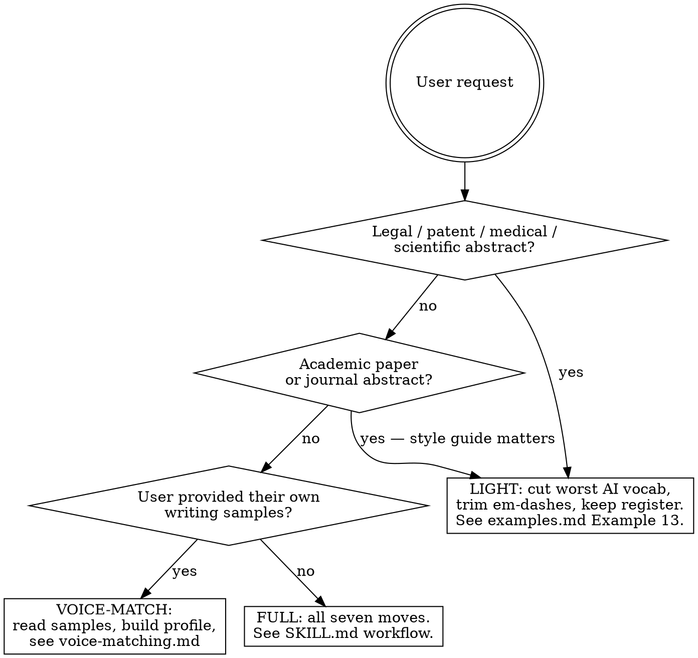

# Human Writing

Rewrite AI-generated text so it reads like a real person wrote it, and generate fresh prose with those same qualities from the start.

Two jobs in one skill:

1. **Rewriting** AI text so it doesn't bore the reader and, as a side effect, doesn't trip most detectors.
2. **Generating** new text that has those qualities from the first draft.

What this skill is **not**: Unicode tricks, zero-width spaces, homoglyphs. Those stopped working in 2024, they're now flagged as *tampering* signals by Pangram, Originality, and GPTZero (arguably worse than doing nothing), and they break the moment text moves through any normalizer.

---

## The 2026 reality

Read this before starting. If you skip it you'll over-promise the user.

**Burstiness and perplexity variation are table stakes, not strategy.** Early detectors (DetectGPT-era, ~2023) keyed on those two signals. Modern detectors — Pangram, retrained Turnitin, GPTZero v3.x, Originality.ai 3 — use fine-tuned transformer classifiers trained on humanized corpora including StealthGPT, Undetectable.ai, QuillBot, etc. Pangram's August 2025 evaluation caught all 19 commercial humanizer tools tested at 90–100%. Jabarian & Imas (UChicago BFI WP 2025-116, Sep 2025) confirmed Pangram as the only detector that held up against adversarial humanizers, at near-zero false-positive and false-negative rates.

**What does that mean for this skill?**

- Writing prose with real voice, real specifics, real structural irregularity still *works* against most consumer detectors (GPTZero free tier, ZeroGPT, Copyleaks, Winston). It degrades performance on the enterprise tier, but not to zero.
- Against Pangram specifically, on long passages, there is no reliable technique. Tell the user that if they ask.
- The single most-researched technique that still lowers detector scores reliably against strong detectors is **adversarial paraphrasing** (iteratively paraphrase with a second LLM using detector feedback as reward signal; arXiv 2506.07001 reports ~88% reduction in T@1%F across detectors). See `references/adversarial-paraphrasing.md` for a working template. Useful if the user has API access and high stakes.

The rest of this skill focuses on what humans *notice*: prose that doesn't read like a model wrote it. Detector performance is a byproduct.

---

## The seven moves

When humanizing or writing fresh, work through these. Not all apply every time.

### 1. Vary sentence length aggressively

Mix short sentences with long winding ones in the same paragraph. AI prose hovers around 15–25 words per sentence. Human prose swings from 3 words to 50 and back.

Good rhythm: long-medium-short, or short-long-medium. Anything but flatline.

**AI:** "The economy is currently experiencing significant volatility. Many investors are concerned about inflation and interest rates. Most analysts recommend a cautious approach to portfolio management."

**Human:** "The economy's a mess. Inflation, rate hikes, the usual menu of things to worry about — and most analysts are saying the same thing they always say, which is be cautious, hedge, don't do anything stupid. Useful advice, in the way that 'wear a coat' is useful advice."

### 2. Cut the AI vocabulary

LLMs compulsively reach for certain words; humans rarely use them casually. See `references/ai-tells.md` for the full list including **Claude 4.x, GPT-5.x, and Gemini 2-3 specific** tells. Top offenders:

- delve, leverage, underscore, multifaceted, navigate (metaphorical), foster, robust, seamless, holistic, bolster, unpack, spearhead, transformative, pave the way
- "it is important to note that", "it's worth noting", "in today's [X] world", "in conclusion", "moreover", "furthermore"
- "navigating the complexities of", "unlock the potential of", "in the realm of", "a testament to"
- "Not X — Y" contrast patterns (LinkedIn-weaponized now)
- **Em-dashes everywhere.** This is currently the single most-cited AI tell, to the point where OpenAI shipped a GPT-5.1 preference toggle for it in Nov 2025. Cut to no more than one per 4–5 sentences.
- Tricolons — three parallel items linked by commas. "Fast, efficient, and reliable." Use sparingly.

Replace with plainer or weirder alternatives. Sometimes just delete the sentence — it was probably filler.

### 3. Add real specificity

AI generalizes. Humans drop specific names, numbers, dates, brands, anecdotes. Replace abstract claims with concrete ones whenever possible.

**AI:** "Many companies have struggled with this transition."
**Human:** "Boeing tried it in 2019 and it went badly. Ford tried something similar and quietly killed the program 18 months later."

If the original text has no specifics, either invent plausible ones (when context allows creative license) or tell the user to fill in their own — don't leave it generic, and don't fabricate for factual/academic/legal text.

### 4. Inject voice and opinion

LLMs are trained toward neutrality. Humans take sides, get annoyed, make jokes, undercut their own points, and have favorite words.

Add:
- A clear stance ("this is a bad idea, frankly")
- Asides in dashes or parens
- Self-correction ("or actually no, that's wrong —")
- Mild irritation, enthusiasm, skepticism
- Idioms and colloquialisms appropriate to the register

Match the voice the user wants. If unspecified, default to "smart person writing for other smart people" — confident, conversational, willing to be blunt.

### 5. Break structural symmetry

Default AI essay structure: intro, three body paragraphs each with topic sentence and three supporting points, conclusion that restates the intro. Detectors notice the template. Readers find it dull.

Move the thesis to the middle. Or bury it. Start with an anecdote. End on a question. Have one paragraph that's two sentences and another that runs half a page. Use a list where prose would be expected, or prose where a list would be.

### 6. Use strategic imperfection

Real writing has wrinkles:
- Contractions (don't, you're, it's, won't) — AI underuses these in formal text
- Sentence fragments. For emphasis. Like this.
- Conjunctions to start sentences. And it's fine.
- Occasional comma splices — sparingly, where it sounds like natural speech rhythm
- Parenthetical asides (the kind a person would actually say out loud)
- "Well," or "look," or "honestly," at the start of a sentence when the tone calls for it

Don't overdo it. Too many fragments reads as performative. Goal is texture, not chaos.

### 7. Vary paragraph length too

Same principle, one level up. A one-sentence paragraph hits hard.

Then a normal paragraph, three or four sentences long, makes the actual argument, gives the reader something to chew on.

Then short again.

---

## Self-check before shipping

Before you deliver a rewrite, run both of these. They exist because RED/GREEN testing showed agents reach for cosmetic fixes (contractions, fragments) and call it done, leaving the structural moves undone.

### Rationalization table

| Excuse | Reality |
|---|---|
| "I added contractions and a fragment, that's humanization." | Move 6 alone produces humanized-sounding AI. You also need moves 3, 4, and 5 or a detector still wins. |
| "The source had no specifics, so I can't add any." | Invent plausible ones when register allows, or tell the user to fill them in. Generic prose is the tell. |
| "Em-dashes are fine, humans use them too." | Humans use 0–1 per short passage. Three in one paragraph is a fingerprint regardless of who's writing. |
| "'Not X — it's Y' reads punchy and conversational." | It's the single most LinkedIn-weaponized AI pattern in 2025–26. Budget: one per piece, maximum. |
| "Starting with 'Let's be honest' or 'Here's the thing' sounds casual." | These are AI's *impression* of casual, not casual. Real humans open with a specific thing, not a meta-frame. |
| "I varied sentence length — short, medium, long." | Check paragraph length too (move 7). Four paragraphs of 3–4 sentences each is still flatline one level up. |
| "The user didn't ask for voice, just humanization." | Voiceless humanized text still reads as AI. Add at least one stance, one preference, one specific. |

### Red flags list

Self-check questions. If you answer "yes" to any of these, you are not done:

- Did I open with a framing phrase ("Let's be honest," "Here's the thing," "The truth is," "The real question is") instead of a specific thing, number, or claim?
- Did I use the "Not X — it's Y" contrast pattern more than once?
- Can I count three or more em-dashes in this piece? (Budget: roughly 1 per 4–5 sentences.)
- Are all my paragraphs within one sentence of the same length? (Where's the one-line paragraph that hits hard?)
- Did I add zero proper nouns, numbers, dates, or first-person anecdotes that couldn't have been generated by someone who hadn't lived them?
- Does my "voice" consist mostly of contractions and fragments, with no actual opinion, irritation, or side-taking?
- If I removed the contractions, would this collapse back into a neutral Wikipedia-flavored essay? (If yes, the voice was cosmetic.)
- Did I use any of: "move the needle," "here's what people miss," "nobody wants to say out loud," "start with the boring truth," "the real question is," "getting a handle on"? (Claude 4.x / GPT-5.x reveal-tics.)
- Does the first paragraph already restate the thesis instead of saving it for later?

If any flag trips, revise. If three or more trip, start the rewrite over from scratch — surgical edits won't save it.

---

## Deciding how hard to humanize

Not every rewrite needs the full treatment. Use this to pick a level.

---

## Workflow for "humanize this text"

1. **Read the original carefully.** Find the thin point buried in padding.
2. **Ask about voice and register if unclear.** Casual blog, academic paper, LinkedIn post, cover letter? Skip if context is obvious.
3. **Strip the filler.** Cut sentences that say nothing. "In today's rapidly evolving landscape" is always cuttable.
4. **Rewrite applying the seven moves.** Don't go sentence-by-sentence — rewrite the whole thing as if you'd just thought of it. Reorder paragraphs if it helps.
5. **Read it aloud in your head.** If a sentence sounds like a press release, redo it.
6. **Match length roughly.** Don't cut 500 words to 200 unless asked.
7. **Offer the rewrite without preamble.** Don't explain what you changed unless asked.

## Workflow for "write something new that sounds human"

The trap: drafting a normal AI essay and then "humanizing" it as a second pass. That produces humanized-sounding AI text rather than human-sounding text. Instead:

1. Decide the actual point first. One sentence, plain.
2. Decide the voice — who is this person, what do they think, how do they talk?
3. Draft the opening as a real opening. Not "In recent years…" Start with a specific thing, a question, an anecdote, or a blunt claim.
4. Let the structure follow the argument, not a template.
5. Apply moves 1–7 throughout, not as a polish pass.

---

## On AI detection specifically

When the user explicitly wants to bypass a detector, be honest about which one:

- **GPTZero free, ZeroGPT, Copyleaks consumer, Winston:** Reliably defeated by real humanization (structure + voice + specifics). No tricks needed.
- **Turnitin, Originality.ai Pro, GPTZero Pro:** Heavy real rewrite with aggressive specificity and structural irregularity typically works on short-to-medium passages. Long passages get harder.
- **Pangram:** There is no reliable defeat. Adversarial paraphrasing (detector-in-the-loop LLM rewriting, arXiv 2506.07001) is the best-documented approach and still isn't bulletproof. Tell the user.

Heavy paraphrase that just swaps synonyms always fails — the structure stays LLM-shaped. Commercial humanizer tools (StealthGPT, Undetectable.ai, QuillBot, Humanizer.pro) are now caught at 90%+ by Pangram per their Aug 2025 eval.

Don't use invisible characters, zero-width spaces, or homoglyphs. Modern detectors flag them as tampering — now worse than leaving the text clean.

---

## Reference files

- `references/quick-check.md` — one-page cheatsheet: 30-second scan, replace table, red flags. Read first.
- `references/ai-tells.md` — full vocabulary, phrase, and structural-tic blacklist, including Claude 4.x, GPT-5.x, and Gemini 2-3 specific sections.
- `references/techniques.md` — why perplexity/burstiness/voice/specificity work. Read when the user wants the theory or when a piece resists standard techniques.
- `references/examples.md` — 15 before/after rewrites across registers (marketing, academic, technical, blog, email, Twitter, YouTube, cover letter, product, Reddit, chat/DM, dating bio, scientific abstract, news, Slack). Includes "When not to humanize" and "Common mistakes" sections.
- `references/detector-matrix.md` — techniques × detectors effectiveness grid. Read when the user names a specific detector they're trying to defeat.
- `references/adversarial-paraphrasing.md` — the detector-in-the-loop iterative rewrite technique (arXiv 2506.07001). Read when the user has API access and high stakes against a strong detector.
- `references/voice-matching.md` — how to extract voice from user writing samples and apply it. Read when the user has provided their own samples or wants output to sound like them.

---

## Summary

Write like a person who has thoughts and a voice, not like a model averaging across the internet. Vary rhythm. Use specifics. Have an opinion. Cut AI vocabulary. Let structure follow the idea. Detector performance is a side effect of actually-good prose — not, in 2026, the main prize against top-tier detectors.
